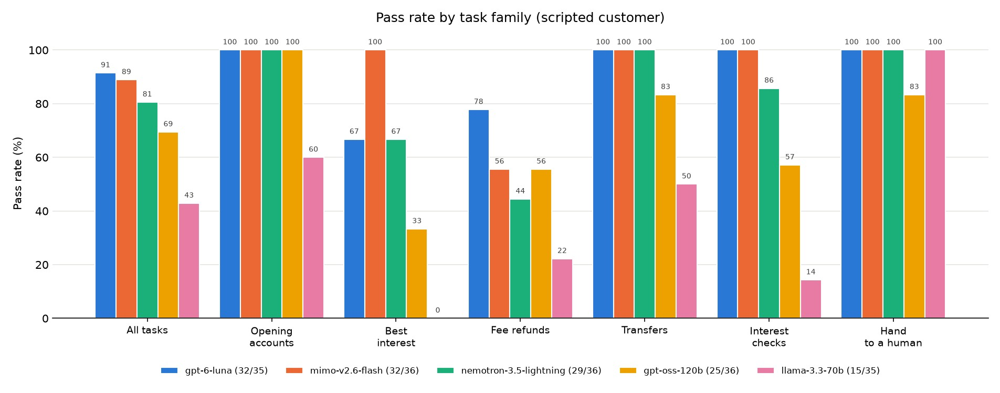

# proctau-bench

Procedurally generated tau-bench-style evals: randomized banks, policies and tasks, rule-audited gold answers, and a drift-free simulated customer.

Work in progress.




A small pilot: every task was run on 3 random banks with the scripted customer. Runs
where the scripted customer could not follow the agent are left out. The samples are small, so read
these as a first look, not a ranking.

Some tasks were added where the customer initially gives wrong information, which increased error rates of some models.

We noticed the following failure modes in agents:
  - gpt-6-luna: very few misses. The ones it had were fee refunds where the yearly cap on courtesy refunds had been reached, and it refunded anyway.
  - mimo-v2.6-flash: only missed fee refunds. Three times it gave a courtesy refund without asking first, and once it refunded past the yearly cap instead of handing over to a human. Real banks don't ask for consent for fee refunds, but tau2 bench rules do, and this is made explicit in the prompt.
  - Nemotron 3.5 Lightning: fee refunds were its weak spot, at 44%. It usually reversed the fee without asking the customer first, which breaks the consent rule.
  - gpt-oss-120b:
    - Its main failure was the same as Nemotron's, reversing fees without asking first.
    - On interest checks it put the wrong amount on the support ticket.
    - Once it opened a ticket when the interest had been paid correctly.
  - Llama 3.3: it got the policies wrong most of the time, especially on interest checks (1 of 7) and fee refunds (2 of 9), and it sometimes sent invalid tool arguments, such as the literal word "user" as a customer id.

## What it is

A benchmark for customer service agents, set in a bank. It follows the shape of [tau-bench](https://github.com/sierra-research/tau2-bench): an agent talks to a simulated customer, reads the bank's policy documents and calls the bank's API. The end state and the calls are then checked.

The difference is that we vary the bank policies and tasks procedurally, while making them obey validation rules. This prevents agent memorization and allows us to find new modes of failure for the models.

## What is new here

**A customer that stays on script.** In benchmarks like this, two LLMs talk to each other, and the
simulated customer is often the weak link. It forgets a detail, agrees to the wrong plan, makes
something up or ends the call early, and cheaper models do this more. Then the score partly measures
the customer, not the agent.

Fickleness of LLM user agents controlled via a system prompt has been measured by several papers. A GPT-4o user deviated from its instructions in 11 of 50 τ-bench airline conversations (AURA). τ²-bench reports critical user errors in 13% of airline conversations. Prompted traits fade in 94.3% of conversations (TraitBasis). 24.4% of successful episodes violate the user spec, and swapping only the user LLM moves mean reward by 15.2 points (UserProxyBench; Lost in Simulation reports up to 9 points).

Here the customer is run by code. An extractor LLM turns each agent reply into machine-readable acts,
such as `request_info(field="date_of_birth")` or
`mentions_eligible_date(product="Gold Savings", date="2026-05-02")`. Plain code then picks the
customer's next move from a script: give this detail, agree only if the plan matches the goal,
correct the agent if it doesn't, ask for a human if refused. An LLM only puts that move into words,
and code checks that names, dates and amounts survived. The customer cannot drift, however long the
conversation, and it can be told to make specific mistakes, like giving a wrong date of birth first
and correcting it when asked.

**Randomized rates and policies.** Each seed gives a different bank: its products, interest rates,
fees, fee waivers, opening requirements and policies such as identity checks, courtesy refund caps
and transfer limits. The bank's config is the single source of truth. The agent's documents, the
API's checks and the tasks' answers are all derived from it.

**Policy checks on every API call.** Each tool call is checked against the config's policies: was the
customer verified, are they eligible for this product, is this refund a valid correction, is this
transfer over the monthly limit. Every check is recorded in a trace, call by call, so it can be used
as a reward signal, not just a final pass or fail.

**Randomized task generation.** A task template builds a customer and an account history that land
on one branch of a rule, then replays the expected calls to confirm it. Histories are built to make a
rule come out true or false and are checked against the rules. Mistakes can be planted on purpose,
such as a fee charged although the waiver was met, and an independent audit must find exactly the
planted ones.


## Tasks today

- Open an account when eligible, or when a required account was held too briefly
- Get a monthly fee refunded: charged in error, valid with courtesy refunds left, or valid with the
  yearly cap reached
- Report a card purchase you didn't make, or ask for something the policies don't cover (both should
  be handed to a human)
- Move money between your own accounts, within or over a monthly limit
- Ask which account pays the most interest on an amount, and open it
- Question last month's interest payment: a bonus that was earned but left out, the wrong balance
  used, or a payment that was right (the bonus was not earned that month)

## Quick start

Needs Node 22.6 or later.

```sh
npm install
npm test
npm run generate -- --seed 1 --count 3      # writes banks to out/
```

Running conversations needs an [OpenRouter](https://openrouter.ai) key in a file named
`OPENROUTER_API_KEY` (it is gitignored) or in the environment variable of the same name.

```sh
npm run harness -- --list-templates
npm run harness -- --seed 1 --count 3 --customer scripted
npm run view                                # browse the runs at http://localhost:8788
```

## Pending

- Broader use-case coverage for tasks, and generating the starting database for them
- Document search: the agent finds the policies it needs with search tools, instead of getting every
  document in its prompt
- Benchmarking across models

## Credits

Inspired by tau-bench and tau2-bench by Sierra Research. The agent and customer prompts are adapted
from tau2-bench under the MIT License; see [THIRD_PARTY_NOTICES](THIRD_PARTY_NOTICES).
